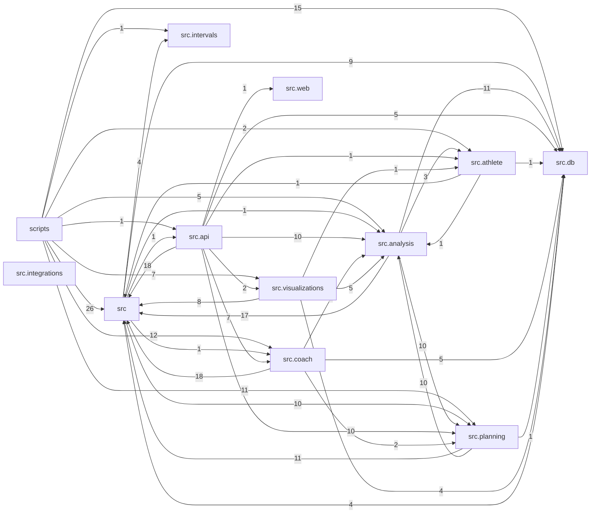

# Code map

> Generated by `python scripts/code_graph.py` from the source. **Do not edit by hand**; a test fails when it
> no longer matches the code. The same graph as data is `docs/codegraph/graph.json` (every node and edge).

180 modules (91 src, 24 scripts, 65 tests) · 704 functions and methods · 54 classes · 22 tables · 52 routes · 32 log events · schema version 15.

## How to use this instead of exploring

- Find where something lives: search this file for the name. Every module has a `### path` heading.
- Ask the graph a question without reading code: `python scripts/code_graph.py show <name>` prints a node and
  everything pointing at it or leaving it. `<name>` can be a module (`src.sync`), a function (`incremental_sync`),
  a table (`table:signals`), a route (`route:POST /api/chat/send`) or an event (`event:sync.done`).
- **Calls are best effort.** Only calls that resolve to a name defined in this repo are drawn. Dispatch through a
  table or callback is invisible, so *no callers listed* means *none resolved*, not *dead*. Imports, tables, routes
  and events are exact.
- The rules that must not be broken are in `CLAUDE.md`; section *Rules and what they govern* maps each one to files.

## Packages

Edge labels count module-level imports between packages. Arrows point from importer to imported.

| package | modules | what it is |
|---|---|---|
| `scripts` | 24 | — |
| `src` | 17 | — |
| `src.analysis` | 13 | — |
| `src.api` | 9 | — |
| `src.athlete` | 2 | — |
| `src.coach` | 14 | — |
| `src.db` | 4 | — |
| `src.integrations` | 1 | — |
| `src.intervals` | 2 | — |
| `src.planning` | 18 | — |
| `src.visualizations` | 9 | — |
| `src.web` | 2 | — |
| `tests` | 65 | — |

## Entry points

### Scripts

| script | what it does | uses |
|---|---|---|
| `scripts/ask.py` | Conversational coaching session with tool use, transcript saving, and session summary. | cli, coach.session, coach.settings |
| `scripts/backfill_notes.py` | Backfill athlete_note from intervals.icu activity chat threads. | clock, db.store, intervals.client, sync |
| `scripts/backfill_signals.py` | File the athlete's earlier writing as signals. | coach.backfill, coach.memory, db.schema |
| `scripts/bootstrap_plan.py` | Derive this athlete's tier ladder from their own synced riding, and store it. | db.schema, planning.bootstrap, planning.constants, planning.ladder_ops, planning.progression |
| `scripts/checkin.py` | Weekly check-in — prompts for subjective feel, then generates coaching response. | analysis.training_plan, cli, coach.session, coach.tools |
| `scripts/code_graph.py` | Build, check and query the code graph: every module, function, table, route and log event in the | cli, codegraph, codegraph_render |
| `scripts/cycle_review.py` | 4-week training-cycle review — the wider look that replaces the weekly check-in when a | analysis.cycle, analysis.training_plan, cli, clock, coach.session, db.schema |
| `scripts/dedupe_activities.py` | Detect and remove duplicate activities. | db.schema, sports |
| `scripts/eval_signals.py` | Run the signal extractor over the gold set and report how it did. | coach.extract, coach.memory, coach.signal_eval |
| `scripts/fetch_history.py` | Fetch full history from intervals.icu and store in local SQLite. | clock, history_fetch |
| `scripts/generate_charts.py` | Generate all visualization charts and the single-page dashboard. | visualizations.calendar_view, visualizations.dashboard, visualizations.distribution, visualizations.load, visualizations.pmc, visualizations.recovery +1 |
| `scripts/import_strava_archive.py` | Import Strava data archive into the activities table. | db.schema, sports |
| `scripts/import_transcripts.py` | Bring the command line's old conversation transcripts into the conversation tables. | coach.memory, db.schema |
| `scripts/logs.py` | Read the application log. | applog |
| `scripts/migrate.py` | Inspect and apply schema migrations. | db.migrations, db.schema |
| `scripts/plan_build.py` | Show what the rolling plan asks for, and optionally write it to Zwift. | analysis.dates, athlete.profile, clock, db.schema, planning.archetypes, planning.blocks +5 |
| `scripts/seed_goals.py` | Seed the goals table with known athlete targets. | db.schema, goals |
| `scripts/seed_profile.py` | Seed / update the athlete_profile table (height, weight, FTP). | athlete.profile, clock, config, db.schema |
| `scripts/serve.py` | Run the local Fitness Coach app. | api.app, config, db.schema, firstrun |
| `scripts/status.py` | Where your setup has got to, and the one command to run next. | firstrun |
| `scripts/support_bundle.py` | Pack what a person helping would need into one zip. | support |
| `scripts/sync.py` | Manual incremental sync — same logic the agent runs silently at startup. | sync |
| `scripts/sync_now.py` | Run one maintenance cycle: pull from intervals.icu, roll the plan, push the horizon. | clock, db.schema, maintenance |
| `scripts/weekly_summary.py` | Generate weekly summaries — the one-time compression that keeps future check-ins cheap. | analysis.weekly, cli, coach.summarize, db.schema |

### HTTP routes

Non-GET routes require the `X-Fitness-Token` header (`src/api/guard.py`). `screen` = called from `src/web/index.html`.

| route | handler | screen |
|---|---|---|
| `DELETE /api/chat/memory/{note_id}` 🔒 | `api.chat:memory_delete` | yes |
| `GET /` | `api.app:home` |  |
| `GET /api/activities` | `api.app:activities` |  |
| `GET /api/chat/due` | `api.chat:due_status` | yes |
| `GET /api/chat/memory` | `api.chat:memory_list` | yes |
| `GET /api/chat/sessions` | `api.chat:sessions` | yes |
| `GET /api/chat/sessions/{session_id}` | `api.chat:session_detail` | yes |
| `GET /api/chat/status` | `api.chat:status` | yes |
| `GET /api/cycles/{start_date}` | `api.app:cycle_detail` |  |
| `GET /api/derived` | `api.app:derived` |  |
| `GET /api/fitness` | `api.app:fitness` |  |
| `GET /api/goals` | `api.setup:goals_list` | yes |
| `GET /api/health` | `api.app:health` |  |
| `GET /api/history` | `api.setup:history_status` | yes |
| `GET /api/ladder` | `api.setup:ladder` | yes |
| `GET /api/load` | `api.app:load` |  |
| `GET /api/load-correction` | `api.app:load_correction` |  |
| `GET /api/plan` | `api.app:plan` |  |
| `GET /api/plan/outline` | `api.app:plan_outline_route` |  |
| `GET /api/plan/overview` | `api.app:plan_overview` | yes |
| `GET /api/plan/progression` | `api.app:plan_progression` |  |
| `GET /api/plan/sessions` | `api.app:plan_sessions` |  |
| `GET /api/plan/state` | `api.app:plan_state` |  |
| `GET /api/plan/week` | `api.app:plan_week` |  |
| `GET /api/reviews/latest` | `api.app:review_latest` |  |
| `GET /api/reviews/pending` | `api.app:review_pending` |  |
| `GET /api/session` | `api.app:session_token` | yes |
| `GET /api/settings` | `api.setup:settings` | yes |
| `GET /api/setup` | `api.setup:setup` | yes |
| `GET /api/signals` | `api.signals:list_signals` | yes |
| `GET /api/snapshot` | `api.app:snapshot` |  |
| `GET /api/snapshot.txt` | `api.app:snapshot_text` |  |
| `GET /api/weeks` | `api.app:weeks` |  |
| `GET /app` | `api.app:web_app` |  |
| `GET /calendar` | `api.app:calendar` |  |
| `GET /calendar.html` | `api.app:calendar_html_alias` |  |
| `GET /chat-test` | `api.app:chat_test` |  |
| `GET /dashboard` | `api.app:dashboard` |  |
| `GET /dashboard.html` | `api.app:dashboard_html_alias` |  |
| `POST /api/cache/clear` 🔒 | `api.app:cache_clear` |  |
| `POST /api/chat/ask` 🔒 | `api.chat:ask` | yes |
| `POST /api/chat/sessions/{session_id}/end` 🔒 | `api.chat:session_end` | yes |
| `POST /api/database` 🔒 | `api.setup:set_up_database` | yes |
| `POST /api/history` 🔒 | `api.setup:fetch_history` | yes |
| `POST /api/ladder` 🔒 | `api.setup:keep_ladder` | yes |
| `POST /api/plan/regenerate` 🔒 | `api.setup:regenerate` | yes |
| `POST /api/profile/ftp` 🔒 | `api.setup:record_ftp` | yes |
| `POST /api/signals/{signal_id}/dismiss` 🔒 | `api.signals:dismiss` | yes |
| `POST /api/signals/{signal_id}/restore` 🔒 | `api.signals:restore` | yes |
| `PUT /api/chat/memory/{note_id}` 🔒 | `api.chat:memory_edit` | yes |
| `PUT /api/goals` 🔒 | `api.setup:goals_save` | yes |
| `PUT /api/settings` 🔒 | `api.setup:save_settings` | yes |

## Modules

`imports` and `used by` are module-level edges (scripts and tests listed apart). `(lazy)` = imported inside a function.

### Package scripts

#### scripts/ask.py

Conversational coaching session with tool use, transcript saving, and session summary.

- imports: cli, coach.session, coach.settings
- used by: —

#### scripts/backfill_notes.py

Backfill athlete_note from intervals.icu activity chat threads.

- imports: clock, db.store, intervals.client, sync
- used by: —
- defs: run(days, dry_run)

#### scripts/backfill_signals.py

File the athlete's earlier writing as signals.

- imports: coach.backfill (lazy), coach.memory (lazy), db.schema (lazy)
- used by: —
- defs: main(argv)

#### scripts/bootstrap_plan.py

Derive this athlete's tier ladder from their own synced riding, and store it.

- imports: db.schema, planning.bootstrap, planning.constants, planning.ladder_ops, planning.progression
- used by: —
- defs: compare_to_fallback(ladder); main()

#### scripts/checkin.py

Weekly check-in — prompts for subjective feel, then generates coaching response.

- imports: analysis.training_plan, cli, coach.session, coach.tools
- used by: —
- defs: prompt_for_feel()
- private helpers: 1

#### scripts/code_graph.py

Build, check and query the code graph: every module, function, table, route and log event in the

- imports: cli, codegraph, codegraph_render
- used by: —
- defs: main(argv); outputs(); show(query, as_json); stale()
- constants: DOCS, GRAPH_PATH, MAP_PATH

#### scripts/cycle_review.py

4-week training-cycle review — the wider look that replaces the weekly check-in when a

- imports: analysis.cycle, analysis.training_plan (lazy), cli, clock, coach.session (lazy), db.schema
- used by: —
- defs: run(as_of, metrics_only, verbose)
- private helpers: 1

#### scripts/dedupe_activities.py

Detect and remove duplicate activities.

- imports: db.schema, sports
- used by: —
- defs: find_duplicates(conn); main()
- constants: DURATION_TOLERANCE_SECS
- private helpers: 1
- tables: reads activities; writes activities

#### scripts/eval_signals.py

Run the signal extractor over the gold set and report how it did.

- imports: coach.extract (lazy), coach.memory (lazy), coach.signal_eval (lazy)
- used by: —
- defs: main(argv)

#### scripts/fetch_history.py

Fetch full history from intervals.icu and store in local SQLite.

- imports: clock, history_fetch
- used by: —
- defs: main(argv)

#### scripts/generate_charts.py

Generate all visualization charts and the single-page dashboard.

- imports: visualizations.calendar_view, visualizations.dashboard, visualizations.distribution, visualizations.load, visualizations.pmc, visualizations.recovery, visualizations.volume
- used by: —
- defs: generate(open_browser, also_individual)
- constants: CHARTS, CHARTS_DIR

#### scripts/import_strava_archive.py

Import Strava data archive into the activities table.

- imports: db.schema, sports
- used by: —
- defs: build_record(row); existing_dates(conn); load_csv_direct(csv_path); load_csv_from_zip(zip_path); run(source_path, dry_run); upsert_strava_activities(conn, records)
- constants: STRAVA_TYPE_MAP
- private helpers: 4
- tables: reads activities; writes activities

#### scripts/import_transcripts.py

Bring the command line's old conversation transcripts into the conversation tables.

- imports: coach.memory (lazy), db.schema (lazy)
- used by: —
- defs: main(argv)

#### scripts/logs.py

Read the application log.

- imports: applog
- used by: —
- defs: line(row); main(argv)
- constants: SKIP

#### scripts/migrate.py

Inspect and apply schema migrations.

- imports: db.migrations, db.schema
- used by: —
- defs: main()

#### scripts/plan_build.py

Show what the rolling plan asks for, and optionally write it to Zwift.

- imports: analysis.dates, athlete.profile, clock, db.schema, planning.archetypes (lazy), planning.blocks, planning.constants, planning.plans, planning.progression, planning.progression_store, planning.tiers_store
- used by: —
- defs: derive_state(today, start_tier, persist); main(); print_week(sessions, watts, steps)
- constants: DAYS
- private helpers: 3

#### scripts/seed_goals.py

Seed the goals table with known athlete targets.

- imports: db.schema, goals
- used by: —
- defs: goals_from_config(); seed(reset)
- tables: reads goals; writes goals

#### scripts/seed_profile.py

Seed / update the athlete_profile table (height, weight, FTP).

- imports: athlete.profile, clock, config, db.schema
- used by: —
- defs: defaults(); update(metric, value, effective_date, note)

#### scripts/serve.py

Run the local Fitness Coach app.

- imports: api.app (lazy), config, db.schema, firstrun
- used by: —
- defs: main()
- private helpers: 1

#### scripts/status.py

Where your setup has got to, and the one command to run next.

- imports: firstrun
- used by: —
- defs: main(argv)

#### scripts/support_bundle.py

Pack what a person helping would need into one zip.

- imports: support
- used by: —
- defs: main(argv)

#### scripts/sync.py

Manual incremental sync — same logic the agent runs silently at startup.

- imports: sync
- used by: —

#### scripts/sync_now.py

Run one maintenance cycle: pull from intervals.icu, roll the plan, push the horizon.

- imports: clock (lazy), db.schema (lazy), maintenance (lazy)
- used by: —
- defs: main()
- constants: LOG_PATH
- private helpers: 2

#### scripts/weekly_summary.py

Generate weekly summaries — the one-time compression that keeps future check-ins cheap.

- imports: analysis.weekly, cli, coach.summarize (lazy), db.schema
- used by: —
- defs: run_week(week_start, force, metrics_only, done)

### Package src

#### src/applog.py

The application log: what happened, never what anyone said.

- imports: —
- used by: analysis.report, api.app, api.chat, api.jobs, clock, coach.extract, coach.memory, coach.session, coach.stream, coach.tools +8
- defs: class _Quiet [handleError]; error(name, exc, **fields); event(name, level, exc, **fields); files(directory); log_dir(); parse_since(text, now); problems(hours, directory); read(since, level, event_like, limit, directory); release(); scrub(text, extra); warning(name, exc, **fields)
- constants: BACKUPS, DEFAULT_DIR, DENY, ENV_DIR, FILE_NAME, LEVELS, LIST_LIMIT, MAX_BYTES, MESSAGE_LIMIT, SECRET_ENV, VALUE_LIMIT
- private helpers: 4
- tested by: test_applog, test_applog_guard, test_applog_sites, test_applog_tools, test_firstrun

#### src/cli.py

What a command-line script does when the thing it needs is missing.

- imports: coach.settings (lazy), intervals.client (lazy)
- used by: scripts.ask, scripts.checkin, scripts.code_graph, scripts.cycle_review, scripts.weekly_summary
- defs: friendly_errors(); utf8_output()
- tested by: test_missing_key

#### src/clock.py

Time, in the two flavours this project actually needs.

- imports: applog, config (lazy)
- used by: analysis.activities, analysis.compliance, analysis.cycle, analysis.dates, analysis.derive, analysis.fitness, analysis.load, analysis.report, analysis.training_plan, analysis.weekly +35
- defs: athlete_timezone(); local_date_of(utc_iso); today_local(); today_local_iso(); utc_now(); utc_now_iso()
- constants: DEFAULT_TIMEZONE
- emits: clock.timezone_fallback
- tested by: test_api_jobs, test_api_signals, test_coach_memory, test_coach_tools, test_config, test_empty_database, test_signals

#### src/codegraph.py

The code graph: every module, symbol, table, route and log event in the repo, and the edges

- imports: applog (lazy), db.migrations (lazy)
- used by: codegraph_render, scripts.code_graph
- defs: class Graph [describe, find]; class _Module; class _Walker [generic_visit, owner, visit_Attribute, visit_Call, visit_ClassDef, visit_Constant, visit_FunctionDef, visit_Name]; build(root); dumps(data); module_id(path, root); stable(data)
- constants: EVENT_RE, HTTP_METHODS, LOG_LEVELS, OUT_DIR, READ_RE, ROOT, SOURCE_DIRS, SQL_VERB, WRITE_RE
- private helpers: 12
- tested by: test_codegraph

#### src/codegraph_render.py

Renders the code graph as `docs/CODEMAP.md`: the version of it an agent reads instead of exploring.

- imports: codegraph
- used by: scripts.code_graph
- defs: render(data)
- constants: DEF_CAP, DOC_WIDTH, LIST_CAP
- private helpers: 4
- tested by: test_codegraph

#### src/config.py

The athlete's configuration, loaded once and validated at the door.

- imports: planning.archetypes (lazy), planning.safety (lazy)
- used by: analysis.report, api.setup, clock, coach.settings, coach.suggest, config_write, firstrun, goals, planning.archetypes, planning.constants +6
- defs: class Athlete [zone]; class Coach; class Config; class ConfigError; class Goal; class Integrations; class IntervalsIcu; class Plan; class Profile; class Server; config(); load(path, *, create_if_missing); parse(text); reset(); weekday(name, where)
- constants: CONFIG_DIR, CONFIG_PATH, EXAMPLE_PATH, REPO_ROOT, TEXT_LIMITS, WEEKDAYS
- private helpers: 4
- tested by: conftest, test_api_setup, test_archetype_overrides, test_availability, test_coach_suggest, test_config, test_config_drives_the_plan, test_config_write +6

#### src/config_write.py

Change settings in `config/athlete.yaml` without losing what is written around them.

- imports: config
- used by: api.setup
- defs: class ConfigWriteError; apply(text, changes); update(changes, path)
- private helpers: 5
- tested by: test_api_setup, test_config_write, test_input_hardening

#### src/firstrun.py

Where a setup has got to, and what to do next.

- imports: applog (lazy), clock (lazy), config (lazy), db.schema (lazy), planning.blocks (lazy), planning.constants (lazy), planning.plans (lazy), planning.tiers_store (lazy)
- used by: api.setup, scripts.serve, scripts.status, support
- defs: class Check; checks(db_path); interpreter(); ready(db_path); report(db_path)
- constants: REPO_ROOT
- private helpers: 16
- tables: reads activities, athlete_profile, plan_progression, prescribed_sessions; writes —
- tested by: test_api_setup, test_applog_tools, test_coach_settings, test_firstrun, test_ride_limits

#### src/goals.py

The athlete's goals. One source: the `goals` table.

- imports: config
- used by: analysis.report, api.setup, coach.tools, planning.overview, scripts.seed_goals
- defs: class GoalError; active(conn); add(conn, description, target_date, priority); dated(conn); from_config(); set_status(conn, goal_id, status); sync(conn, goals); update(conn, goal_id, **fields)
- constants: DESCRIPTION_LIMIT, PRIORITIES
- private helpers: 2
- tables: reads goals; writes goals
- tested by: test_config_drives_the_plan, test_goals, test_input_hardening, test_overview

#### src/history_fetch.py

Pull the full history from intervals.icu into the local database, in 90-day windows.

- imports: applog, db.schema, db.store, intervals.client
- used by: api.setup, scripts.fetch_history
- defs: class HistoryError; date_chunks(start, end, chunk); fetch_all(start, end, progress)
- constants: CHUNK_DAYS
- emits: history.chunk_failed
- tested by: test_api_jobs

#### src/maintenance.py

The unattended maintenance cycle: pull, roll, reconcile, push.

- imports: applog, clock, db.schema, intervals.client (lazy), planning.constants, planning.export (lazy), sync (lazy)
- used by: api.app, api.chat, api.jobs, api.setup, scripts.sync_now
- defs: class AlreadyRunning; needs_push(conn, today, plan_name); run_cycle(today, push_enabled, plan_name, silent); summarise(result)
- constants: LOCK_PATH, LOCK_STALE_SECONDS
- private helpers: 4
- tables: reads prescribed_sessions; writes —
- emits: maintenance.cycle, maintenance.cycle_failed, maintenance.push_failed, maintenance.skipped
- tested by: test_api_jobs, test_applog_sites, test_calendar_orphans, test_coach_runs, test_maintenance

#### src/signal_briefing.py

What the coach is told about the athlete's own account of things.

- imports: clock, planning.advisories, signals
- used by: analysis.report, planning.overview
- defs: advisory_lines(advisories); age(day, today); block(today, week_type); strip(today, week_type, conn); themes(all_threads, today); watch_line(t, today)
- constants: HEADER, QUOTE_CHARS, THEMES_MAX, THEME_MIN_MENTIONS, THEME_MIN_SPAN_DAYS, THEME_RECENT_DAYS, WATCH_MAX
- private helpers: 2
- tested by: test_signal_briefing

#### src/signals.py

The signal ledger: what the athlete has said about how life and training are going.

- imports: clock, db.schema
- used by: api.signals, coach.backfill, coach.due, coach.extract, coach.tools, signal_briefing
- defs: class SignalError; all_threads(today, conn); clean(kind, *, topic, severity, state, quote, on_date, start_date, end_date); digest(today, days, conn); dismiss(signal_id, reason); recent_threads(today); record(kind, *, source, source_ref, extractor_version, observed_at, **fields); recorded(source, source_ref); restore(signal_id); summary(*, since, until, kind, topic, min_severity, conn); threads(rows, today); timeline(*, since, until, kind, topic, min_severity, limit, dismissed); watch_list(today, conn); watch_list_from(grouped)
- constants: ESCALATE_COUNT, ESCALATE_WITHIN_DAYS, FADE_DAYS, KINDS, QUOTE_MAX, SEVERITY_LABELS, SILENT_DAYS, STATES, THREAD_GAP_DAYS, TOPIC_MAX
- private helpers: 4
- tables: reads signals; writes signals
- tested by: test_api_signals, test_backfill, test_coach_extract, test_coach_memory, test_coach_tools, test_signal_briefing, test_signal_eval, test_signals

#### src/sports.py

What counts as which sport. One table, because there were six.

- imports: —
- used by: analysis.activities, analysis.compliance, db.store, scripts.dedupe_activities, scripts.import_strava_archive, visualizations.calendar_view
- defs: sport_group(activity_type); types_in(group)
- constants: CYCLING_TYPES, OTHER, SPORT_GROUPS
- tested by: test_sports

#### src/support.py

A bundle someone can send when something is wrong: one zip, nothing in it that is theirs to keep.

- imports: api.setup (lazy), applog, config (lazy), db.schema, firstrun (lazy)
- used by: scripts.support_bundle
- defs: build(out_dir, db_path); contents(path)
- constants: README, REPO_ROOT, TEXT_SETTINGS
- private helpers: 4
- tables: reads activities, sync_log; writes —
- emits: support.section_failed, support.settings_unreadable
- tested by: test_applog_tools

#### src/sync.py

Incremental sync from intervals.icu into local SQLite.

- imports: analysis.compliance, applog, clock, db.schema, db.store, intervals.client, planning.roller
- used by: api.chat, coach.session, maintenance, scripts.backfill_notes, scripts.sync
- defs: flatten_messages(messages, athlete_id); incremental_sync(silent); sync_activity_notes(client, activities); sync_window(); window_for(data_type)
- constants: ADHERENCE_LOOKBACK_DAYS, MAX_INCREMENTAL_DAYS, NOTE_LOOKBACK_DAYS, OVERLAP_DAYS
- private helpers: 3
- tables: reads sync_log, wellness; writes —
- emits: sync.activities_failed, sync.adherence_failed, sync.done, sync.events_failed, sync.notes_failed, sync.plan_failed, sync.records_skipped, sync.wellness_failed
- tested by: test_applog_sites, test_coach_runs, test_sync

### Package src.analysis

#### src/analysis/activities.py

Activity breakdown — sport distribution, recent training, load patterns.

- imports: analysis.dates, analysis.load, clock, db.schema, sports
- used by: analysis.report, api.app, planning.overview, planning.progression_store, planning.tiers_store, visualizations.distribution, visualizations.load, visualizations.volume
- defs: recent_activities(days); sport_distribution(days); week_volume(conn, monday); weekly_load_by_sport(weeks); yearly_volume()
- tables: reads activities, wellness; writes —
- tested by: test_empty_database, test_week_volume

#### src/analysis/compliance.py

Plan adherence — matches rows in planned_workouts, written by the rolling plan

- imports: athlete.profile, clock, db.schema, sports
- used by: analysis.report, sync
- defs: compliance_summary(weeks); match_planned_workouts(start, end); recent_planned_workouts(days)
- constants: COMPLETED_PCT
- private helpers: 3
- tables: reads activities, planned_workouts; writes planned_workouts
- tested by: test_empty_database

#### src/analysis/cycle.py

Deterministic rollup of a completed mesocycle, plus storage of the review built from it.

- imports: analysis.load, analysis.training_plan, clock, db.schema
- used by: analysis.report, analysis.weekly, api.app, coach.session, scripts.cycle_review
- defs: cycle_context_text(metrics, prev); cycle_for_review(on); cycle_metrics(cycle); latest_review(); previous_review(before_start); save_review(plan_name, metrics, content, model)
- private helpers: 3
- tables: reads activities, cycle_reviews, planned_workouts, training_plan_weeks, wellness; writes cycle_reviews
- tested by: test_empty_database, test_progression_store

#### src/analysis/dates.py

Week boundaries — one definition, imported everywhere.

- imports: clock
- used by: analysis.activities, analysis.derive, analysis.weekly, coach.due, planning.blocks, planning.outline, planning.overview, planning.progression_store, planning.roller, planning.tiers_store +1
- defs: last_completed_week(on); monday_of(d); mondays_between(start, end); sunday_of(d)
- tested by: test_archetype_overrides, test_bootstrap, test_invariants, test_week_volume

#### src/analysis/derive.py

Derived metrics — every comparison the coach would otherwise do by eye.

- imports: analysis.dates, analysis.load, athlete.profile, clock, db.schema, planning.constants
- used by: analysis.report, api.app, planning.blocks
- defs: consistency(conn, today, days); ctl_ramps(conn, today); derived_metrics(today); derived_text(m); intensity_distribution(conn, today, days); recovery_baselines(conn, today); rpe_vs_prescribed(conn, today, days); weekly_load(conn, today, weeks, plan_name)
- constants: EASY_IF_CEILING, HARD_IF_FLOOR
- private helpers: 1
- tables: reads activities, planned_workouts, training_plan_weeks, wellness; writes —
- tested by: test_empty_database, test_planning, test_progression_store

#### src/analysis/fitness.py

PMC (Performance Management Chart) analysis.

- imports: clock, db.schema
- used by: analysis.report, api.app
- defs: ctl_history(weeks); ctl_trend(weeks); current_fitness(); peak_ctl(years)
- private helpers: 1
- tables: reads wellness; writes —
- tested by: test_empty_database

#### src/analysis/forecast.py

Deterministic CTL/ATL/TSB projection — no ML, just the same EWMA recursion intervals.icu

- imports: db.schema
- used by: visualizations.pmc
- defs: project_fitness()
- constants: ATL_DAYS, CTL_DAYS
- tables: reads planned_workouts, wellness; writes —
- tested by: test_empty_database

#### src/analysis/load.py

Training load that accounts for intervals.icu having analysed some rides at the wrong FTP.

- imports: clock, db.schema
- used by: analysis.activities, analysis.cycle, analysis.derive, analysis.report, api.app, athlete.profile, visualizations.calendar_view
- defs: corrected_activities(conn, since); ctl_correction(conn, today); effective_tss(row, raw); load_correction_text(today); reset_ftp_cache(); sum_effective_tss(conn, start, end); tracked_ftp_strict(activity_date)
- constants: ATL_DAYS, CTL_DAYS
- private helpers: 2
- tables: reads activities, athlete_profile, wellness; writes —
- tested by: test_empty_database

#### src/analysis/report.py

Assembles all analysis signals into a structured coaching context.

- imports: analysis.activities, analysis.compliance, analysis.cycle, analysis.derive, analysis.fitness, analysis.load, analysis.training_plan, analysis.weekly, analysis.wellness, applog, athlete.profile, clock +12
- used by: api.app, api.chat, coach.session
- defs: athlete_profile(); build_coaching_context(recent_days, trend_weeks, history_weeks); coaching_context_text(ctx); coaching_memory_entries(per_type)
- constants: DEFAULT_MEMORY_PER_TYPE, MEMORY_CHAR_BUDGET, MEMORY_PER_TYPE, RAW_ACTIVITY_DAYS
- private helpers: 9
- tables: reads chat_sessions, coaching_log, prescribed_sessions, subjective_feel; writes —
- emits: report.section_failed
- tested by: test_availability, test_coach_gate_rule, test_coach_memory, test_coach_memory_screen, test_coach_suggest, test_config_drives_the_plan, test_empty_database, test_limit_signals +2

#### src/analysis/training_plan.py

Reads the hand-seeded training_plan_weeks table.

- imports: clock, db.schema
- used by: analysis.cycle, analysis.report, api.app, api.chat, coach.due, coach.session, scripts.checkin, scripts.cycle_review
- defs: current_cycle(on, plan_name); current_week(on, plan_name); cycle_data_complete(plan_name); cycles(plan_name); just_completed_cycle(on, plan_name); plan_summary(on, plan_name)
- private helpers: 2
- tables: reads training_plan_weeks; writes —
- tested by: test_empty_database, test_progression_store

#### src/analysis/weekly.py

Per-week rollup and storage — the weekly counterpart to cycle.py.

- imports: analysis.cycle, analysis.dates, clock, db.schema, planning.constants
- used by: analysis.report, api.app, coach.session, coach.summarize, scripts.weekly_summary
- defs: has_qualitative_content(m); save_summary(m, narrative, model); summaries_between(start, end); summarized_weeks(); summary_lines(summaries); week_metrics(week_start, plan_name)
- tables: reads activities, planned_workouts, subjective_feel, training_plan_weeks, weekly_summaries, wellness; writes weekly_summaries
- tested by: test_empty_database, test_progression_store

#### src/analysis/wellness.py

Recovery and wellness signal analysis — HRV, sleep, resting HR trends.

- imports: clock, db.schema
- used by: analysis.report
- defs: hrv_summary(days); recovery_flags(days); rhr_trend(days); sleep_summary(days)
- private helpers: 1
- tables: reads wellness; writes —
- tested by: test_empty_database

### Package src.api

#### src/api/app.py

Local HTTP server — phase 12A of the CLI-to-app migration.

- imports: analysis.activities, analysis.cycle, analysis.derive, analysis.fitness, analysis.load, analysis.report, analysis.training_plan, analysis.weekly, api.cache, api.chat, api.guard, api.setup +16
- used by: scripts.serve
- defs: activities(days); cache_clear(); calendar(weeks, ahead); calendar_html_alias(); chat_test(); cycle_detail(start_date); dashboard(); dashboard_html_alias(); derived(); fitness(trend_weeks); health(); home(); lifespan(_app); load(weeks); load_correction(); plan(); plan_outline_route(on, weeks, met_in_four); plan_overview(on); plan_progression(limit); plan_sessions(start, days); plan_state(on); plan_week(on); record_unhandled(request, exc); refuse_bad_input(request, exc); review_latest(); review_pending(); session_token(); snapshot(); snapshot_text(); web_app(); weeks(start, end)
- constants: CHAT_TEST_PAGE, SCHEDULER_ENABLED, SYNC_INTERVAL_MINUTES
- private helpers: 1
- tables: reads activities, plan_progression, prescribed_sessions; writes —
- emits: api.unhandled, maintenance.unhandled
- tested by: test_api_guard, test_api_jobs, test_api_setup, test_api_signals, test_applog_sites, test_coach_memory, test_coach_memory_screen, test_coach_runs +8

#### src/api/cache.py

Freshness-keyed cache for expensive page builds.

- imports: db.schema
- used by: api.app, api.chat
- defs: class BuildCache [clear, get, stats]; freshness_key()
- constants: CACHE

#### src/api/chat.py

Chat over Server-Sent Events — phase 12C.

- imports: analysis.report, analysis.training_plan (lazy), api.cache, api.ids, applog, clock, coach.chat_store, coach.due, coach.memory, coach.prompt, coach.session, coach.settings +5
- used by: api.app
- defs: class AskRequest; class NoteBody; ask(req); due_status(); memory_delete(note_id); memory_edit(note_id, body); memory_list(limit); session_detail(session_id); session_end(session_id); sessions(limit); status()
- private helpers: 9
- tables: reads coaching_log; writes chat_sessions, coaching_log
- emits: chat.run_failed, chat.sync_failed, chat.turn_failed, memory.summarise_failed
- tested by: test_coach_memory, test_coach_memory_screen, test_coach_runs, test_coach_settings, test_conversation_locking

#### src/api/guard.py

Who may talk to this server.

- imports: —
- used by: api.app
- defs: class Guard; allowed_hosts(); refusal(method, headers); routes(app)
- constants: LOOPBACK, SAFE_METHODS, TOKEN, TOKEN_HEADER, TOKEN_PATH
- private helpers: 1
- tested by: test_api_guard, test_api_jobs, test_api_setup, test_api_signals, test_coach_memory, test_coach_memory_screen, test_coach_runs, test_coach_settings +4

#### src/api/ids.py

Types for what a route accepts.

- imports: —
- used by: api.chat, api.signals

#### src/api/jobs.py

One long task at a time, run off the request thread, with a status the page can poll.

- imports: applog, maintenance
- used by: api.setup
- defs: class Job [snapshot, start]; class JobBusy
- constants: HISTORY, LOG_LINES
- private helpers: 1
- emits: job.failed
- tested by: test_api_jobs

#### src/api/setup.py

What the setup screen and the settings screen talk to.

- imports: api.jobs, athlete.profile (lazy), clock, config, config_write, db.schema, firstrun, goals, history_fetch (lazy), maintenance, planning.bootstrap, planning.ladder_ops
- used by: api.app, support
- defs: class Changes; class FtpBody; class GoalsBody; class HistoryBody; class LadderBody; current(config); fetch_history(body); goals_list(); goals_save(body); history_status(); keep_ladder(body); ladder(); record_ftp(body); regenerate(); save_settings(body); set_up_database(); settings(); setup()
- constants: FTP_RANGE
- private helpers: 3
- tested by: test_api_jobs, test_api_setup, test_applog_sites, test_coach_suggest, test_goals

#### src/api/signals.py

The Signals screen: everything the athlete has told the coach, filterable, and theirs to correct.

- imports: api.ids, clock, signals
- used by: api.app
- defs: class Dismissal; dismiss(signal_id, body); list_signals(kind, topic, min_severity, since, until, dismissed, limit); restore(signal_id)
- constants: MAX_ROWS

### Package src.athlete

#### src/athlete/profile.py

Manually-maintained athlete profile — height, weight, FTP — tracked as a dated history

- imports: analysis.load (lazy), clock, db.schema
- used by: analysis.compliance, analysis.derive, analysis.report, api.setup, scripts.plan_build, scripts.seed_profile, visualizations.pmc
- defs: current_profile(); get_metric(metric, as_of); metric_history(metric); set_metric(metric, value, effective_date, note)
- constants: METRICS
- tables: reads athlete_profile; writes athlete_profile
- tested by: test_api_jobs, test_empty_database

### Package src.coach

#### src/coach/backfill.py

Read what the athlete has already written and file it as signals.

- imports: clock, coach.chat_store, coach.extract, coach.memory, db.schema, signals
- used by: scripts.backfill_signals
- defs: class Item; collect(); run(client, *, apply, items, on_item)
- tables: reads activities, chat_sessions, subjective_feel; writes —
- tested by: test_backfill

#### src/coach/chat_store.py

Persistence for chat sessions — phase 12C.

- imports: clock, db.schema
- used by: api.chat, coach.backfill, coach.memory, coach.session
- defs: close_idle(minutes, now); end_session(session_id); is_closed(session_id, minutes, now); list_sessions(limit); load_history(session_id); new_session(model, mode, title); replace_history(session_id, messages); session_exists(session_id); set_title_if_unset(session_id, text)
- constants: IDLE_CLOSE_MINUTES
- tables: reads chat_messages, chat_sessions; writes chat_messages, chat_sessions
- tested by: test_backfill, test_coach_memory, test_coach_memory_screen, test_coach_runs, test_coach_settings, test_conversation_locking

#### src/coach/due.py

When a check-in is worth having: the weekly one and the block review.

- imports: analysis.dates, analysis.training_plan (lazy), planning.constants, signals (lazy)
- used by: api.chat
- defs: checkin_status(conn, today); review_status(conn, today, cycle_list); status(conn, today, cycle_list)
- constants: MIN_GAP_DAYS, OVERDUE_DAYS, OVERDUE_WEEKS, REVIEW_OVERDUE_DAYS
- private helpers: 4
- tables: reads coaching_log, cycle_reviews, plan_progression; writes —
- tested by: test_coach_due

#### src/coach/extract.py

Reading what the athlete said and filing it as signals.

- imports: applog, coach.settings, signals
- used by: coach.backfill, coach.memory, scripts.eval_signals
- defs: class Extraction; extract(text, today, client, model, open_threads); file_signals(found, *, source, source_ref, observed_at); parse(raw, text, today); quoted(quote, text)
- constants: FOLLOWUP_WORDS, GIST_WORDS, MAX_FOLLOWUPS, MAX_TEXT_CHARS, MAX_TOKENS, MIN_QUOTE_CHARS, SYSTEM, TOOL, VERSION
- private helpers: 6
- emits: extract.done, extract.no_filing
- tested by: test_applog_sites, test_coach_extract, test_coach_memory

#### src/coach/memory.py

What the coach remembers from a conversation.

- imports: applog, clock, coach.chat_store, coach.extract, coach.settings, db.schema
- used by: api.chat, coach.backfill, coach.session, scripts.backfill_signals, scripts.eval_signals, scripts.import_transcripts
- defs: athlete_turns(messages, mode); eligible(messages, mode); import_legacy(); stale_sessions(idle_minutes, now); summarise(session_id, client); summarise_pending(idle_minutes, limit, client, on_error); summarise_session(session_id, client)
- constants: MIN_CHARS
- private helpers: 2
- tables: reads chat_sessions, transcripts; writes chat_messages, chat_sessions, coaching_log
- emits: memory.summarise_failed
- tested by: test_backfill, test_coach_memory, test_coach_runs, test_conversation_locking, test_missing_key

#### src/coach/prompt.py

System prompt builder for the coaching layer.

- imports: —
- used by: api.chat, coach.session
- defs: build_system_prompt(athlete_snapshot, mode)
- constants: CHECKIN_FORMAT, CONVERSATION_FORMAT, CYCLE_REVIEW_FORMAT, FORMATS, HARD_FORMAT_REMINDER, METHODOLOGY, VOICE
- tested by: test_coach_suggest

#### src/coach/session.py

Claude coaching layer — check-in and conversational modes with tool use.

- imports: analysis.cycle, analysis.report, analysis.training_plan, analysis.weekly, applog, clock, coach.chat_store, coach.memory, coach.prompt, coach.settings, coach.stream, coach.summarize +2
- used by: api.chat, scripts.ask, scripts.checkin, scripts.cycle_review
- defs: class CoachSession [ask, end_session, reset]; checkin(feel_context, verbose); checkin_inputs(feel_context); cycle_review(on, verbose); cycle_review_inputs(cyc, verbose); finish_checkin(response, model, session_id, verbose); finish_cycle_review(inputs, response)
- constants: MAX_TOKENS
- private helpers: 3
- tables: reads —; writes coaching_log
- emits: coach.weekly_summary_skipped
- tested by: test_coach_memory, test_coach_runs, test_coach_settings, test_missing_key

#### src/coach/settings.py

Whether the coach can run, and on which model: one place, read at call time.

- imports: config
- used by: api.chat, cli, coach.extract, coach.memory, coach.session, coach.summarize, scripts.ask
- defs: class MissingKey; api_key(); enabled(); extractor_model(); has_key(); model(); refusal(); status()
- constants: DEFAULT_EXTRACTOR, ENV_EXTRACTOR, ENV_KEY, ENV_MODEL
- tested by: test_coach_memory, test_coach_runs, test_coach_settings, test_conversation_locking, test_missing_key

#### src/coach/signal_eval.py

Scoring the extractor against the gold set.

- imports: —
- used by: scripts.eval_signals
- defs: load(path, private); match(case, predicted); score(results)
- constants: BAR, GOLD_PATH, HIGH, PRIVATE_PATH
- tested by: test_signal_eval

#### src/coach/stream.py

Streaming agentic turn — phase 12C.

- imports: applog, coach.tools
- used by: api.chat, coach.session
- defs: class Event [to_json]; run_turn(client, model, system, messages, max_tokens); stream_turn(client, model, system, messages, max_tokens, tools)
- constants: MAX_ITERATIONS
- emits: coach.tool_crashed, coach.turn
- tested by: test_applog_sites, test_coach_runs, test_coach_tools, test_conversation_locking

#### src/coach/suggest.py

A change the coach would like the athlete to consider, offered as a button.

- imports: config, planning.constants
- used by: coach.tools
- defs: suggest_change(setting, value, reason)
- constants: SETTINGS
- private helpers: 1
- tested by: test_coach_suggest

#### src/coach/summarize.py

The one place a model is used for compression rather than coaching.

- imports: analysis.weekly, coach.settings (lazy)
- used by: coach.session, scripts.weekly_summary
- defs: weekly_narrative(m)
- constants: MAX_TOKENS, SUMMARY_MODEL, SYSTEM
- private helpers: 1
- tested by: test_missing_key, test_summarize

#### src/coach/tools.py

Tool definitions and implementations for the coaching agent.

- imports: applog, clock, coach.suggest, db.schema, goals (lazy), signals
- used by: coach.stream, scripts.checkin
- defs: calculate_ramp_target(target_ctl, target_date); execute_tool(name, inputs); log_life_event(type, start_date, end_date, severity, note, logged_via); log_subjective_feel(feel_score, energy, motivation, legs, notes, date, logged_via); query_history(query_type, start_date, end_date, limit); query_signals(view, kind, topic, min_severity, start_date, end_date, limit); update_goal(action, description, target_date, priority, goal_id)
- constants: NOW, TOOL_FN_MAP, TOOL_SCHEMAS
- tables: reads activities, goals, planned_workouts, subjective_feel, wellness; writes subjective_feel
- emits: coach.tool_error
- tested by: test_applog_sites, test_coach_suggest, test_coach_tools, test_goals, test_signal_briefing, test_signals

### Package src.db

#### src/db/migrations.py

Versioned schema migrations.

- imports: applog, clock, db.schema
- used by: api.app, codegraph, db.schema, scripts.migrate
- defs: add_column(conn, table, column, decl); backup_before_migrating(conn, db_path, version); current_version(conn); migrate(db_path, verbose); status(db_path); table_exists(conn, table)
- constants: BACKUPS_KEPT, BASELINE_SQL, CHAT_SESSIONS_SQL, CUTOVER_MONDAY, LATEST_VERSION, MIGRATIONS, NEW_PLAN_NAME, OLD_PLAN_NAME, PLANS_SQL, PLAN_PROGRESSION_SQL, PRESCRIBED_SESSIONS_SQL, TIERS_SQL +2
- private helpers: 17
- emits: db.migrated, db.migration_failed
- tested by: test_api_signals, test_applog_sites, test_applog_tools, test_archetype_overrides, test_availability, test_backfill, test_bootstrap, test_calendar_horizon +31

#### src/db/schema.py

- imports: db.migrations (lazy)
- used by: analysis.activities, analysis.compliance, analysis.cycle, analysis.derive, analysis.fitness, analysis.forecast, analysis.load, analysis.report, analysis.training_plan, analysis.weekly +37
- defs: get_connection(db_path); migrate_db(db_path); read_connection(db_path); write_connection(db_path)
- constants: DB_PATH
- tested by: conftest, test_api_jobs, test_api_signals, test_backfill, test_calendar_horizon, test_coach_extract, test_coach_gate_rule, test_coach_memory +9

#### src/db/store.py

- imports: clock, db.schema, sports
- used by: history_fetch, scripts.backfill_notes, sync
- defs: log_sync(conn, data_type, start, end, records, status); update_activity_notes(notes, db_path); upsert_activities(activities, db_path, skipped); upsert_events(events, db_path); upsert_wellness(wellness, db_path)
- private helpers: 2
- tables: reads activities; writes activities, events, sync_log, wellness
- tested by: test_sports, test_store, test_sync

### Package src.integrations

### Package src.intervals

#### src/intervals/client.py

- imports: —
- used by: cli, history_fetch, maintenance, scripts.backfill_notes, sync
- defs: class IntervalsClient [create_events, delete_events_by_id, get_activities, get_activity_messages, get_athlete, get_events, get_fitness, get_wellness …]; class MissingCredentials
- constants: BASE_URL
- tested by: test_intervals_write, test_missing_key

### Package src.planning

#### src/planning/advisories.py

What the athlete's own account would do to the plan, if it were allowed to.

- imports: —
- used by: signal_briefing
- defs: plan_advisories(watch, gate)
- constants: ACTIONS, EASIER
- private helpers: 1
- tested by: test_advisories

#### src/planning/archetypes.py

Workout archetypes — the parameterised templates a plan is built from.

- imports: config (lazy)
- used by: config, planning.blocks, planning.export, planning.zwo, scripts.plan_build
- defs: class Session [intensity_factor, minutes, name, seconds, summary, tss]; class Step [tss]; catalogue(); hiit(variant, reps, work_min); lit(minutes, variant); sit(variant, reps); strength(minutes, variant); threshold(variant, reps, work_min); variant_names(archetype); variants(archetype)
- constants: DEFAULTS, HIIT_VARIANTS, LIT_VARIANTS, SIT_NOMINAL_PCT, SIT_VARIANTS, STRENGTH_VARIANTS, THRESHOLD_VARIANTS
- private helpers: 10
- tested by: test_archetype_overrides, test_planning, test_zwo

#### src/planning/blocks.py

Plan structure — a rotation of blocks, expanded one week at a time at a given tier.

- imports: analysis.dates, analysis.derive, planning.archetypes, planning.bootstrap (lazy), planning.constants, planning.progression
- used by: analysis.report, firstrun, planning.ladder_ops, planning.outline, planning.progression_store, planning.roller, scripts.plan_build
- defs: class Block [phase]; advance_position(block_index, week_in_block, rotation); build_pattern(ride_days, strength_days, hard, days, long_day, limits); check_fit(rotation, ladder); expand_week(block, week_in_block, tier, monday, plan_name, block_index, week_type, tiers); fitting_variants(block, limit); hard_variant_minutes(); intensity_split(sessions); pattern_for(block, tier, recovery, reentry, tiers); plan_limits(ride_days); plan_rotation(ride_days); plan_week_row(monday, block, block_index, week_in_block, plan_week_number, tier, week_type, plan_name, goal_date, plan_start); rotation_after(block_index); rotation_for(ride_days, strength_days, days, long_day, limits); rotation_rides(rotation); shortest_hard_session(); unfittable_blocks(rotation); weekly_rollup(sessions)
- constants: BLOCK_TYPES, HARD_DAY, LONG_DAY, MAX_HARD_PER_WEEK, MAX_TIER_RIDES, ROLES, ROTATION, ROTATION_LOOP_FROM, UNLIMITED
- private helpers: 12
- tested by: test_availability, test_bootstrap, test_config_drives_the_plan, test_invariants, test_patterns, test_planning, test_progression_store, test_ride_limits +1

#### src/planning/bootstrap.py

Deriving the tier ladder from an athlete's own synced history.

- imports: —
- used by: api.setup, planning.blocks, planning.ladder_ops, planning.outgrown, planning.tiers_store, scripts.bootstrap_plan
- defs: class BootstrapError; class DerivedTier [target_hours, target_min]; class Ladder [cap, floor]; class Observed [as_dict]; class RideLimits [declared]; derive(weeks, band_hours, long_ceiling_min, max_rides, ceiling_setting, limits_for); observe(weeks); summarise(ladder)
- constants: BAND_TOLERANCE, EASY_STEP, FLOOR_EASY_FRACTION, GAPS, HARD_MIN_HIGH, HARD_MIN_LOW, LONG_STEPS, MIN_EASY, MIN_LONG, MIN_RIDDEN_WEEKS, MIN_STEP, RECENT_WEEKS +2
- private helpers: 9
- tested by: conftest, test_bootstrap, test_firstrun, test_ladder_versions, test_limit_signals, test_ride_limits, test_target_minutes

#### src/planning/constants.py

Plan-wide identifiers, read from the athlete's configuration file.

- imports: config
- used by: analysis.derive, analysis.report, analysis.weekly, api.app, api.chat, coach.due, coach.suggest, firstrun, maintenance, planning.blocks +8
- defs: available_days(); configured_slug(); goal_date(); limit_setting(day); long_ride_day(); max_ride_days(); plan_name(); plan_start_monday(); push_calendar(); ride_day_setting(); ride_limits(); strength_days()
- tested by: conftest, test_availability, test_coach_due, test_config_drives_the_plan, test_firstrun, test_invariants, test_planning, test_progression_store +2

#### src/planning/export.py

Push the stored horizon to the intervals.icu calendar.

- imports: clock, planning.archetypes (lazy), planning.constants, planning.roller (lazy), planning.zwo
- used by: maintenance
- defs: build_payload(rows); event_for(row, zwo); is_ours(external_id, plan_name); pending(conn, today, plan_name); push(conn, client, today, plan_name, dry_run); reconcile(conn, client, today, plan_name, horizon_days); rideable(session)
- constants: CATEGORY, MIDNIGHT, SPORT_BY_ARCHETYPE
- private helpers: 3
- tables: reads prescribed_sessions; writes prescribed_sessions
- tested by: test_calendar_orphans, test_export, test_maintenance

#### src/planning/ladder_ops.py

Derive, compare and store the tier ladder. The one implementation behind

- imports: clock, config, db.schema, planning.blocks, planning.bootstrap, planning.constants, planning.plans, planning.tiers_store
- used by: api.setup, scripts.bootstrap_plan
- defs: class LadderError; changes(was, now); derive_now(conn, weeks); preview(weeks); store(replace, weeks); stored(conn)
- constants: FIELDS, LABELS
- private helpers: 1
- tested by: test_ladder_ops

#### src/planning/outgrown.py

Noticing when an athlete has ridden past their own ladder.

- imports: planning.bootstrap
- used by: analysis.report
- defs: class Assessment; assess(weeks, ladder, decided, max_ride_days, ladder_age_weeks, ceiling_setting, limits); describe_options(options); limit_bound(cap, limits); unlock_options(cap, limits, max_ride_days, ceiling_setting)
- constants: HELD_CAP_WEEKS, LIMIT_STEP, MIN_LADDER_AGE_WEEKS, NOTHING, VOLUME_MARGIN, WINDOW_WEEKS
- private helpers: 3
- tested by: test_limit_signals, test_outgrown

#### src/planning/outline.py

The twelve-week view: shape without a promise.

- imports: analysis.dates, planning.blocks, planning.constants, planning.progression
- used by: analysis.report, api.app, planning.overview
- defs: class OutlineWeek; from_state(state, today, weeks, met_in_four, tiers); outline(start_monday, tier, block_index, week_in_block, weeks, horizon_weeks, met_in_four, tiers); summarise(rows, met_in_four, strength_recently_held, tiers)
- constants: DEFAULT_MET_IN_FOUR, OUTLINE_WEEKS
- tested by: test_bootstrap, test_invariants, test_outline

#### src/planning/overview.py

Everything the plan screen shows, in one read: where the gate has put you and why, how this week

- imports: analysis.activities, analysis.dates, goals, planning.constants, planning.outline, planning.plans, planning.progression, planning.progression_store, planning.roller, planning.tiers_store, signal_briefing
- used by: api.app
- defs: overview(conn, today); sessions(conn, today, days)
- constants: HORIZON_DAYS
- private helpers: 1
- tables: reads prescribed_sessions; writes —
- tested by: test_api_signals, test_overview

#### src/planning/plans.py

Plan identity: a slug that never changes, and a name that may.

- imports: clock
- used by: analysis.report, api.app, firstrun, planning.ladder_ops, planning.overview, planning.progression_store, planning.roller, scripts.plan_build
- defs: class PlanRow; active(conn); by_name(conn, name); by_slug(conn, slug); config_fingerprint(payload); ensure(conn, slug, name, started_on, goal_date, config_hash); orphans(conn); rename(conn, slug, new_name); resolve(conn, name, slug); retire(conn, slug); slug_for(name)
- constants: LABELLED_TABLES
- private helpers: 1
- tables: reads plans; writes plans
- tested by: conftest, test_bootstrap, test_config, test_config_drives_the_plan, test_firstrun, test_ladder_versions, test_outgrown, test_plans

#### src/planning/progression.py

The gate: how a week's prescription changes based on what was actually ridden.

- imports: —
- used by: analysis.report, api.app, planning.blocks, planning.outline, planning.overview, planning.progression_store, planning.tiers_store, scripts.bootstrap_plan, scripts.plan_build
- defs: class Decision; class Tier [target_hours, target_min]; classify_week(week, tier, tiers); gate_thresholds(spec); next_state(history, tier, advisories); replay(weeks, start_tier, tiers); trailing_gap(history)
- constants: ADVANCE_MET_WEEKS, CAP_TIER, FLOOR_TIER, MET_FRACTION, PARTIAL_FRACTION, STRENGTH_GATED_TIER, STRENGTH_GATED_WEEKS, STRENGTH_WINDOW, TIERS
- private helpers: 2
- tested by: conftest, test_advisories, test_bootstrap, test_coach_gate_rule, test_invariants, test_ladder_versions, test_limit_signals, test_outgrown +8

#### src/planning/progression_store.py

The gate's memory: reading and writing `plan_progression`.

- imports: analysis.activities, analysis.dates, clock, planning.blocks, planning.constants, planning.plans, planning.progression, planning.tiers_store
- used by: analysis.report, api.app, planning.overview, planning.roller, scripts.plan_build
- defs: catch_up(conn, today, plan_name, start_tier, persist, tiers); current_state(conn, today, plan_name, start_tier, persist, tiers); record_week(conn, graded, decision, block_index, week_in_block, strength_logged, plan_name); rows(conn, plan_name)
- constants: LOOKBACK_WEEKS
- private helpers: 3
- tables: reads plan_progression; writes plan_progression
- tested by: test_bootstrap, test_export, test_invariants, test_limit_signals, test_progression_store

#### src/planning/roller.py

The rolling horizon: a few weeks of dated sessions, re-derived and stored.

- imports: analysis.dates, clock, planning.blocks, planning.constants, planning.plans, planning.progression_store, planning.tiers_store
- used by: planning.export, planning.overview, sync
- defs: external_id(plan_name, on, role); external_id_prefix(plan_name); horizon(conn, today, plan_name, weeks, start_tier, persist_state, tiers, rotation); plan_week_number(monday); store_horizon(conn, today, plan_name, weeks, start_tier, persist_state)
- constants: FREEZE_DAYS, HORIZON_WEEKS
- private helpers: 3
- tables: reads planned_workouts, prescribed_sessions; writes planned_workouts, prescribed_sessions, training_plan_weeks
- tested by: test_api_signals, test_archetype_overrides, test_availability, test_bootstrap, test_calendar_orphans, test_coach_gate_rule, test_config_drives_the_plan, test_export +7

#### src/planning/safety.py

The rules a configuration file may not break.

- imports: —
- used by: config
- defs: check_all(overrides, defaults); violations(archetype, variant, cfg)
- constants: ARCHETYPES, HIIT_MAX_PCT, HIIT_MAX_REST_RATIO, HIIT_MIN_BOUT_MIN, LIT_MAX_PCT, SIT_MAX_WORK_S, SIT_MIN_WORK_S, THRESHOLD_MAX_PCT, THRESHOLD_MIN_BOUT_MIN, THRESHOLD_MIN_WORK_MIN, THRESHOLD_MIN_WORK_REST_RATIO
- private helpers: 5
- tested by: test_archetype_overrides

#### src/planning/tiers_store.py

The stored tier ladder: reading it, writing it, and refusing to guess when it is absent.

- imports: analysis.activities (lazy), analysis.dates (lazy), clock, planning.bootstrap, planning.progression
- used by: analysis.report, api.app, firstrun, planning.ladder_ops, planning.overview, planning.progression_store, planning.roller, scripts.plan_build
- defs: class NotBootstrapped; age_weeks(conn, plan_id, today); current_version(conn, plan_id); fallback(); ladder_for(conn, plan_id, decision); load(conn, plan_id, version); provenance(conn, plan_id); require(conn, plan_id, plan_name); save(conn, plan_id, ladder, replace); weeks_for(conn, through, weeks_back)
- private helpers: 1
- tables: reads tiers; writes tiers
- tested by: conftest, test_bootstrap, test_firstrun, test_ladder_ops, test_ladder_versions, test_limit_signals, test_outgrown

#### src/planning/zwo.py

Session -> Zwift `.zwo` XML.

- imports: planning.archetypes
- used by: planning.export
- defs: safe_component(name); safe_filename(name); session_name(session, prefix); to_zwo(session, name, description)
- constants: AUTHOR, AUTHOR_TAG
- tested by: test_zwo

### Package src.visualizations

#### src/visualizations/calendar_view.py

Week-grid training calendar — health stats + activities + plan adherence per day.

- imports: analysis.load, clock, config, db.schema, sports, visualizations.theme
- used by: api.app, scripts.generate_charts
- defs: build_calendar_html(weeks, ahead); write_calendar(weeks, open_browser)
- constants: CHARTS_DIR, COMPLIANCE_COLORS
- private helpers: 9
- tables: reads activities, planned_workouts, wellness; writes —
- tested by: test_calendar_horizon, test_empty_database, test_outline, test_web_page

#### src/visualizations/dashboard.py

Single-page dashboard — all charts embedded, expand-to-modal, chat placeholder.

- imports: clock, config, db.schema, visualizations.load, visualizations.pmc, visualizations.recovery
- used by: api.app, scripts.generate_charts
- defs: build_dashboard(); write_dashboard(open_browser)
- constants: CHARTS_DIR, DEFAULT_PRESET, RANGE_PRESETS
- private helpers: 3
- tables: reads activities, planned_workouts, wellness; writes —
- tested by: test_empty_database

#### src/visualizations/distribution.py

Sport distribution — donut chart, last 90 days by training time.

- imports: analysis.activities, visualizations.theme
- used by: scripts.generate_charts
- defs: build(days)
- tested by: test_empty_database

#### src/visualizations/load.py

Weekly training load by sport — stacked bar chart, 12 weeks.

- imports: analysis.activities, visualizations.theme
- used by: scripts.generate_charts, visualizations.dashboard
- defs: build(weeks)
- constants: SPORT_ORDER
- tested by: test_empty_database

#### src/visualizations/pmc.py

Performance Management Chart — modeled on intervals.icu's 4-panel PMC:

- imports: analysis.forecast, athlete.profile, clock, db.schema, visualizations.theme
- used by: scripts.generate_charts, visualizations.dashboard
- defs: build(weeks)
- constants: FRESH_MIN, GREY_MIN, OPTIMAL_MIN, ZONE_COLORS
- private helpers: 5
- tables: reads events, wellness; writes —
- tested by: test_empty_database

#### src/visualizations/recovery.py

Recovery dashboard — HRV trend + sleep hours, dual panel, 30 days.

- imports: clock, db.schema, visualizations.theme
- used by: scripts.generate_charts, visualizations.dashboard
- defs: build(days)
- private helpers: 2
- tables: reads wellness; writes —
- tested by: test_empty_database

#### src/visualizations/theme.py

Shared Plotly theme and color palette.

- imports: —
- used by: visualizations.calendar_view, visualizations.distribution, visualizations.load, visualizations.pmc, visualizations.recovery, visualizations.volume
- constants: AXIS, COLORS, LAYOUT, SPORT_COLOR

#### src/visualizations/volume.py

Annual training volume — TSS and estimated hours by year, sourced from wellness.

- imports: analysis.activities, clock, visualizations.theme
- used by: scripts.generate_charts
- defs: build()
- tested by: test_empty_database

### Package src.web

#### src/web/nav.py

The navigation bar shared by every page this server serves.

- imports: —
- used by: api.app
- defs: nav_html(active, bleed); with_nav(html, active, bleed)
- constants: ITEMS
- tested by: test_nav

## Tables

Columns as the migrations leave them (`*` = primary key). Writers and readers are the modules whose own SQL touches
the table; most writes go through `db.store` helpers, so look there first and use `show` for the callers.

### activities

- columns: id*, date, name, type, sport, moving_time, distance, elevation, avg_hr, max_hr, avg_power, max_power, np, tss, ctl, atl, tsb, feel, calories, raw_json, athlete_note
- written by: db.store, scripts.dedupe_activities, scripts.import_strava_archive
- read by: analysis.activities, analysis.compliance, analysis.cycle, analysis.derive, analysis.load, analysis.weekly, api.app, coach.backfill, coach.tools, db.store, firstrun, scripts.dedupe_activities +4

### athlete_profile

- columns: id*, metric, value, effective_date, note, created_at
- written by: athlete.profile
- read by: analysis.load, athlete.profile, firstrun

### chat_messages

- columns: id*, session_id, seq, role, content, created_at
- written by: coach.chat_store, coach.memory
- read by: coach.chat_store

### chat_sessions

- columns: session_id*, started_at, updated_at, ended_at, model, mode, title, summary, summarised_at, followups
- written by: api.chat, coach.chat_store, coach.memory
- read by: analysis.report, coach.backfill, coach.chat_store, coach.memory

### coaching_log

- columns: id*, session_id, date, type, model, content, created_at
- written by: api.chat, coach.memory, coach.session
- read by: analysis.report, api.chat, coach.due

### cycle_reviews

- columns: id*, plan_name, cycle_start, cycle_end, phase, plan_week_start, plan_week_end, weeks, ctl_start, ctl_end, ctl_ramp_per_week, tsb_end, planned_tss, actual_tss, adherence_pct, hrv_build, hrv_rest, metrics_json, content, model, created_at
- written by: analysis.cycle
- read by: analysis.cycle, coach.due

### events

- columns: id*, date, name, category, type, distance_km, raw_json
- written by: db.store
- read by: visualizations.pmc

### goals

- columns: id*, description, target_date, priority, status, created_at, updated_at
- written by: goals, scripts.seed_goals
- read by: coach.tools, goals, scripts.seed_goals

### life_events

- columns: id*, start_date, end_date, type, severity, note, logged_at, logged_via
- written by: —
- read by: —

### plan_progression

- columns: id*, plan_name, week_start, ride_minutes, ride_days, strength_logged, outcome, tier_applied, verdict, tier_next, week_type_next, rotation, block_index, week_in_block, reason, created_at, plan_id, ladder_version
- references: plan_id → plans
- written by: planning.progression_store
- read by: api.app, coach.due, firstrun, planning.progression_store

### planned_workouts

- columns: id*, date, name, planned_tss, planned_duration_min, planned_if, workout_url, matched_activity_id, compliance_status, compliance_pct, planned_kj, description, workout_type
- written by: analysis.compliance, planning.roller
- read by: analysis.compliance, analysis.cycle, analysis.derive, analysis.forecast, analysis.weekly, coach.tools, planning.roller, visualizations.calendar_view, visualizations.dashboard

### plans

- columns: id*, slug, name, started_on, goal_date, config_hash, created_at, retired_at
- written by: planning.plans
- read by: planning.plans

### prescribed_sessions

- columns: id*, plan_name, date, weekday, block_index, block_name, week_in_block, is_recovery_week, role, archetype, variant, prescription, minutes, tss, intensity_factor, params_json, created_at, external_id, remote_event_id, pushed_at, volume_tier, week_type, plan_id
- references: plan_id → plans
- written by: planning.export, planning.roller
- read by: analysis.report, api.app, firstrun, maintenance, planning.export, planning.overview, planning.roller

### schema_migrations

- columns: version*, name, applied_at
- written by: —
- read by: —

### signals

- columns: id*, observed_at, on_date, kind, topic, severity, state, quote, start_date, end_date, source, source_ref, extractor_version, dismissed_at, dismissed_reason
- written by: signals
- read by: signals

### subjective_feel

- columns: id*, date, feel_score, energy, motivation, legs, notes, logged_at, logged_via
- written by: coach.tools
- read by: analysis.report, analysis.weekly, coach.backfill, coach.tools

### sync_log

- columns: id*, synced_at, data_type, start_date, end_date, records, status
- written by: db.store
- read by: support, sync

### tiers

- columns: id*, plan_id, version, tier_index, rides, long_min, hard, hard_min, lit_min, derived_from, notes, created_at
- references: plan_id → plans
- written by: planning.tiers_store
- read by: planning.tiers_store

### training_plan_weeks

- columns: id*, plan_name, plan_start_date, plan_end_date, week_start_date, week_end_date, week_type, phase, phase_number, phase_week_number, plan_week_number, volume_tier, plan_id
- references: plan_id → plans
- written by: planning.roller
- read by: analysis.cycle, analysis.derive, analysis.training_plan, analysis.weekly

### transcripts

- columns: session_id*, started_at, ended_at, model, turns, summary, file_path
- written by: —
- read by: coach.memory

### weekly_summaries

- columns: id*, week_start, week_end, plan_week_number, week_type, phase, planned_tss, actual_tss, sessions, adherence_pct, ctl_end, tsb_end, hrv, rhr, sleep_hrs, mean_rpe, metrics_json, narrative, model, created_at
- written by: analysis.weekly
- read by: analysis.weekly

### wellness

- columns: date*, ctl, atl, tsb, rhr, hrv, hrv_score, sleep_hrs, sleep_score, weight_kg, steps, kcal, feel, raw_json
- written by: db.store
- read by: analysis.activities, analysis.cycle, analysis.derive, analysis.fitness, analysis.forecast, analysis.load, analysis.weekly, analysis.wellness, coach.tools, sync, visualizations.calendar_view, visualizations.dashboard +2

## Log events

Everything `src/applog.py` can write. Read them with `python scripts/logs.py`.

| event | emitted by |
|---|---|
| `api.unhandled` | api.app:record_unhandled |
| `chat.run_failed` | api.chat:_run_structured |
| `chat.sync_failed` | api.chat:_sync_quietly |
| `chat.turn_failed` | api.chat:_run_and_enqueue |
| `clock.timezone_fallback` | clock:athlete_timezone |
| `coach.tool_crashed` | coach.stream:stream_turn |
| `coach.tool_error` | coach.tools:execute_tool |
| `coach.turn` | coach.stream:stream_turn |
| `coach.weekly_summary_skipped` | coach.session:finish_checkin |
| `db.migrated` | db.migrations:migrate |
| `db.migration_failed` | db.migrations:migrate |
| `extract.done` | coach.extract:extract |
| `extract.no_filing` | coach.extract:extract |
| `history.chunk_failed` | history_fetch:fetch_all |
| `job.failed` | api.jobs:Job._run |
| `maintenance.cycle` | maintenance:run_cycle |
| `maintenance.cycle_failed` | maintenance:_cycle |
| `maintenance.push_failed` | maintenance:_cycle |
| `maintenance.skipped` | maintenance:run_cycle |
| `maintenance.unhandled` | api.app:lifespan |
| `memory.summarise_failed` | api.chat:_summarise_quietly, coach.memory:summarise_pending |
| `report.section_failed` | analysis.report:_outgrown, analysis.report:_rolling_plan |
| `support.section_failed` | support:build |
| `support.settings_unreadable` | support:_settings |
| `sync.activities_failed` | sync:incremental_sync |
| `sync.adherence_failed` | sync:incremental_sync |
| `sync.done` | sync:incremental_sync |
| `sync.events_failed` | sync:incremental_sync |
| `sync.notes_failed` | sync:incremental_sync |
| `sync.plan_failed` | sync:incremental_sync |
| `sync.records_skipped` | sync:incremental_sync |
| `sync.wellness_failed` | sync:incremental_sync |

## Rules and what they govern

Each section of `CLAUDE.md` and the files it names. Read the rule before changing the files beside it.

- **Always run Python through the project venv** — api.app
- **Coach notes have one writer** — coach.extract, coach.memory
- **Do not delete the grep/AST guard tests** — clock, goals
- **Every write route is guarded by method, in one place** — api.guard, tests.test_api_guard
- **Read the code map before exploring the repo** — codegraph
- **Signals have one writer and one judge** — signals
- **The application log records events, never words** — applog, scripts.support_bundle, tests.test_applog_guard
- **The coach suggests; the athlete applies** — coach.suggest

## Structure notes

Most depended on (importers among src and scripts):

- `db.schema` — 47
- `clock` — 45
- `planning.constants` — 18
- `applog` — 18
- `config` — 16
- `analysis.dates` — 11
- `planning.progression` — 9
- `analysis.training_plan` — 8
- `planning.plans` — 8
- `planning.tiers_store` — 8
- `analysis.activities` — 8
- `coach.settings` — 7

Import cycles at module level: none.

Cycles that exist only through function-level (lazy) imports:
- config, planning.archetypes
- db.migrations, db.schema

src modules nothing in src or scripts imports (entry points, or candidates for removal): —
